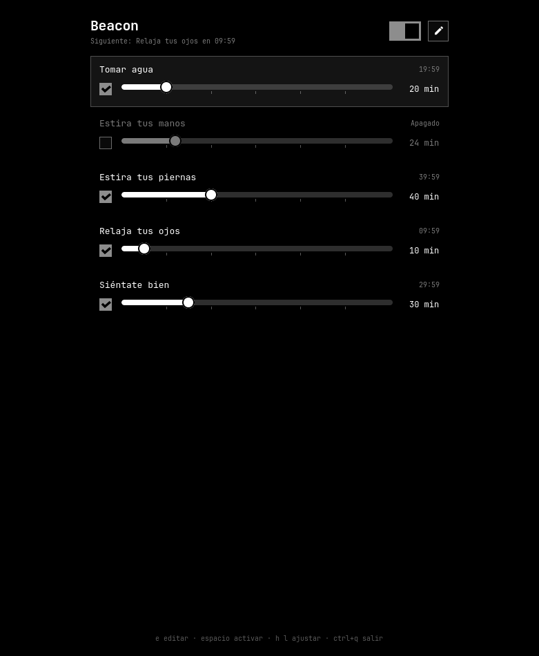

# Beacon

Gentle break reminders, built for [Omarchy](https://omarchy.org).

<p align="center">
  
  
</p>

Beacon does one thing: **every N minutes it sends you a notification, then the
clock starts over.** Set *Drink water* to 20 minutes and you're reminded every
20 minutes, all day.

- **One window.** Each reminder has a checkbox, a slider from 1 to 120 minutes
  and a live countdown. The switch at the top pauses everything.
- **The pencil is the settings.** Tap it to rename or delete reminders, add new
  ones, and choose whether Beacon starts at login.
- **Native to Omarchy.**
  - It reads the current theme's `colors.toml` and `shell.toml` (control states,
    font size, spacing) plus Hyprland's corner rounding and the Omarchy font,
    and restyles live when you switch themes.
  - Notifications go through `omarchy notification send`, so they look like
    every other Omarchy notification, with a **Snooze 5 min** button.
- **Every Omarchy language.** All 50 languages, following
  `~/.config/omarchy/language` live, with right-to-left layout for Arabic,
  Persian, Hebrew and Urdu.
- **A tray icon in the Omarchy bar.** Left click opens Beacon; right click has
  Open, Turn on / Turn off and Quit. It takes the bar's color in every theme,
  and loses its signal bars while reminders are paused.
- **Small and quiet.** Rust and GTK4, one process. If the laptop sleeps, the
  clocks restart quietly instead of firing a backlog.

## Install

```sh
git clone https://github.com/mauneven/beacon
cd beacon
makepkg -si
```

Or build by hand (needs Rust and `gtk4`), for your user only, no root:

```sh
make install-user      # ~/.local/bin and ~/.local/share
```

or system-wide with `make build && sudo make install`.

Then open **Beacon** from the launcher. It opens as a small floating card in
the middle of the screen. The first run sets Beacon to start at
login (there's a checkbox to undo that in the pencil view).

### A key for Beacon (optional)

To open or hide Beacon with a key, bind `beacon --toggle` in
`~/.config/hypr/bindings.lua`.

## Keyboard

| Keys                 | Action                                  |
| -------------------- | --------------------------------------- |
| `j` `k` / `↓` `↑`    | Move between reminders                  |
| `h` `l` / `←` `→`    | Adjust minutes (hold Shift for 5)       |
| `Space` / `Enter`    | Turn the reminder on or off             |
| `t`                  | Pause or resume all reminders           |
| `e`                  | Edit mode (the pencil)                  |
| `n`                  | New reminder                            |
| `r` / `F2`           | Rename (edit mode)                      |
| `x` / `Delete`       | Delete (edit mode)                      |
| `Esc`                | Leave a field, leave edit mode, or hide |

Closing the window (`Super+W`, or `Esc`) only hides it: the reminders keep
running in the background.

## Command line

```text
beacon                 open the window (starts Beacon if needed)
beacon --background    start without a window (used at login)
beacon --toggle        show or hide the window
beacon --snooze <id>   push a reminder 5 minutes out
beacon --autostart on|off
```

## Configuration

Reminders live in `~/.config/beacon/config.toml`:

```toml
enabled = true

[[reminder]]
id = 1
preset = "water"     # a built-in reminder: its name follows Omarchy's language
minutes = 20
enabled = true

[[reminder]]
id = 6
name = "Feed the cat" # your own name: never translated or overwritten
minutes = 90
enabled = true
```

The built-in reminders are created once, in your language. If you change
Omarchy's language later, the ones you haven't renamed switch with it; the
ones you renamed keep your text. Changing the minutes doesn't count as a rename.

### Transparency

Like Flea, Beacon opts its window in to Omarchy's window transparency, so it
follows **Window Transparency** in the Omarchy menu: see-through by default,
solid when *opaque*, frosted blur when *glassy*. `Super+Backspace` toggles it
for the window.

For a see-through background on top of that, give Beacon its own alpha in a
theme's `shell.toml`, or in `~/.config/omarchy/shell.toml` for every theme:

```toml
[beacon]
background-alpha = 0.85
```

## Translations

Strings live in [`i18n/`](i18n), one TOML file per Omarchy language code.
`cargo test` checks that every language has every string and keeps its
`{placeholders}`. Corrections from native speakers are very welcome.

## License

MIT
