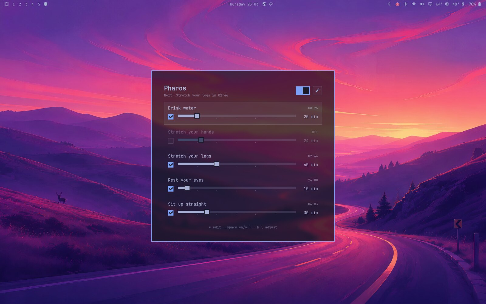
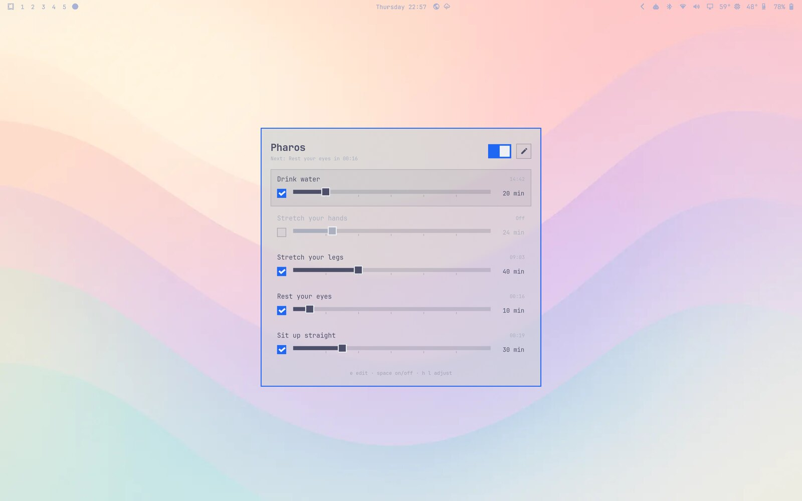
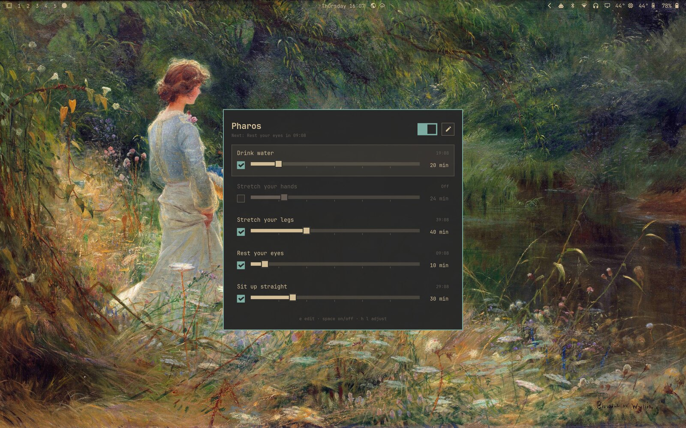
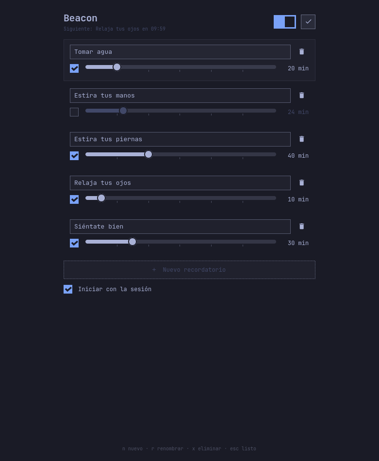

<p align="center">
  
</p>

<h1 align="center">Pharos</h1>

<p align="center">
  Break reminders for <a href="https://omarchy.org">Omarchy</a>.<br>
  Every N minutes, a notification. Then the clock starts over.
</p>

<p align="center">
  
</p>

<p align="center">
  
  
</p>

<p align="center"><sub>Tokyo Night, Catppuccin Latte and Gruvbox. Pharos follows whichever theme you pick.</sub></p>

## Install

```sh
git clone https://github.com/mauneven/pharos
cd pharos
makepkg -si
```

Open **Pharos** from the launcher. From then on it starts with your session and
lives in the tray.

## Use it

1. **Pick the minutes.** Drag a reminder's slider (1 to 120 minutes). The
   countdown on the right starts over each time the notification comes.
2. **Check what you want.** Unchecked reminders stay quiet. The switch at the
   top pauses all of them.
3. **Close the window.** `Super+W` only closes the window. Reminders keep
   running, and the tray icon brings the window back.

When a notification arrives, click it to snooze that reminder for 5 minutes.

### Make your own

Click the pencil to rename or delete reminders, add new ones with
**+ New reminder**, and choose whether Pharos starts at login.

<p align="center">
  
</p>

### Keyboard

| Key           | Action                          |
| ------------- | ------------------------------- |
| `j` `k`       | Move between reminders          |
| `h` `l`       | Fewer / more minutes (Shift: 5) |
| `Space`       | Turn a reminder on or off       |
| `t`           | Pause or resume everything      |
| `e`           | Edit mode                       |
| `n` `r` `x`   | New, rename, delete             |
| `Esc`         | Back, or close the window       |

To open Pharos with a key, bind `pharos --toggle` in
`~/.config/hypr/bindings.lua`.

## Light on memory

Pharos spends almost all day in the background, so that part is tiny. The
clocks, notifications and tray icon run in `pharos`, which loads no GUI
toolkit. The window is a separate program, `pharos-window`, that only exists
while it's open.

| State                        | RAM (PSS) |
| ---------------------------- | --------- |
| In the background            | ~3 MB     |
| Window open                  | ~31 MB    |

Measured on Omarchy with `/proc/<pid>/smaps_rollup`. Closing the window gives
its memory back right away.

## Fits in Omarchy

- **Theme.** Colors, font, spacing and corner rounding come from the current
  Omarchy theme and change live when you switch themes.
- **Language.** All 50 Omarchy languages, following Omarchy's language setting.
  Built-in reminders switch language with it until you rename them.
- **Window.** Opens centered at the size its reminders need. `Super+T` tiles
  it like any window. Follows Omarchy's window transparency (opaque,
  see-through or glassy).
- **Notifications.** Sent with `omarchy notification send`, so they look like
  every other Omarchy notification.
- **Sleep.** After the laptop sleeps, the clocks start over quietly instead of
  firing everything at once.

<details>
<summary><b>Command line</b></summary>

```text
pharos                   open the window (starts Pharos if needed)
pharos --background      start without a window
pharos --toggle          show or hide the window
pharos --snooze <id>     push a reminder 5 minutes out
pharos --autostart on|off
```

</details>

<details>
<summary><b>Config file</b></summary>

Pharos saves everything to `~/.config/pharos/config.toml`. You don't need to
edit it, but you can:

```toml
enabled = true

[[reminder]]
id = 1
preset = "water"       # built in: the name follows Omarchy's language
minutes = 20
enabled = true

[[reminder]]
id = 6
name = "Feed the cat"  # your own name: never translated
minutes = 90
enabled = true
```

For a see-through background, set an alpha in `~/.config/omarchy/shell.toml`
(or in a theme's `shell.toml`):

```toml
[pharos]
background-alpha = 0.85
```

</details>

<details>
<summary><b>Build from source</b></summary>

Needs Rust and `gtk4`.

```sh
make install-user              # ~/.local, no root
make build && sudo make install
cargo test                     # unit and command line tests
cargo test -- --ignored        # end to end: waits for a real notification
```

Translations live in [`i18n/`](i18n), one file per language. Corrections from
native speakers are welcome.

</details>

## License

MIT
